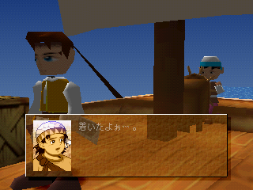
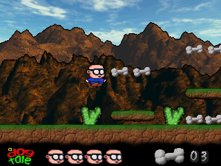
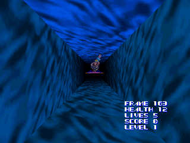

# psxsdk

[](https://pkg.go.dev/go.chrisrx.dev/psx)
[](https://github.com/ChrisRx/psxsdk/actions/workflows/go.yml)
[](https://github.com/ChrisRx/psxsdk/actions/workflows/pages.yml)

The Net Yaroze was Sony's 1990s kit for making PlayStation games at home. psxsdk is a Go toolchain for it: write programs in Go, build them onto discs that boot anywhere, and run them in an emulator, in the browser or on the desktop.

<p>
<a href="https://chrisrx.github.io/psxsdk/examples/terra/"></a>
<a href="https://chrisrx.github.io/psxsdk/examples/dogtale/"></a>
<a href="https://chrisrx.github.io/psxsdk/examples/tunnel/"></a>
</p>

- **Play** [the examples](https://chrisrx.github.io/psxsdk/examples/) in your browser: Sony's Net Yaroze demos and members' games ported to Go, and a few new ones.
- **Write** your own in [the playground](https://chrisrx.github.io/psxsdk/play/), or with nothing but Go installed: `go run go.chrisrx.dev/psx/cmd/nyc@latest disc ./mygame`. [The tutorial](https://chrisrx.github.io/psxsdk/tutorial/) starts from nothing.
- **Read** [Sony's manuals](https://chrisrx.github.io/psxsdk/manuals/), with the FAQs, supplements and tutorial the members' websites carried.

## What it does

- **Write** PlayStation programs in Go, compiled with TinyGo against bindings for the Net Yaroze library that keep Sony's names.
- **Make** their data with converters from PNG, WAV, MIDI and OBJ to the console's TIM, VAG, VAB, SEQ and TMD, each tested against what Sony's own tools made.
- **Build** them into discs that boot without Net Yaroze hardware, with streamed XA/STR files and CD audio tracks.
- **Run** them in an emulator written in Go, which drives the tests headless, runs in a browser and opens a window on the desktop.

## Why

A Net Yaroze program never had a disc of its own: the boot disc loaded the library, and the program came over a serial cable from a PC, so showing a game to anyone meant bringing the whole kit. The members' websites are gone, and the SDK is a set of binaries built for MS-DOS and Windows 95. psxsdk exists so that anyone can still write, build and play these programs, with modern tools, on a disc of their own. [The history](https://chrisrx.github.io/psxsdk/about/) tells the rest.

## Building from source

With Go 1.27 or newer:

```bash
git clone https://github.com/ChrisRx/psxsdk
cd psxsdk
go build -o bin/ ./cmd/... ./tools/...
go test ./...
```

Building the examples also needs a compiler, which `nyc` finds for itself: a tinygo command with the PlayStation targets, or failing that, TinyGo compiled to WebAssembly. The Nix flake provides TinyGo with those targets, the cross binutils, [go-task](https://taskfile.dev), mednafen and a patched [psxe](https://github.com/allkern/psxe):

```bash
nix develop            # or: direnv allow
task build:discs       # every example onto .build/NAME/NAME.cue
task test:emu          # boot each disc in the emulator and compare screenshots
task serve             # build the site and the playground, and serve them on localhost:8000
```

[Getting started](https://chrisrx.github.io/psxsdk/guide/) has more, and [the packages](https://chrisrx.github.io/psxsdk/about/packages/) map the module.

## Layout

| Directory | What is there |
| --- | --- |
| [`yaroze`](yaroze), [`disc`](disc), [`archive`](archive), [`scene`](scene) | What a program imports: the Net Yaroze library, its files on the disc, archives and scenes |
| [`cmd`](cmd) | `nyc`, which builds a program onto a disc in one step, with its compiler built in |
| [`tools`](tools) | The converters, the disc and executable tools, and the emulator's front ends, each [documented](https://chrisrx.github.io/psxsdk/tools/) |
| [`link`](link), [`format`](format) | Executables, discs and the console's file formats |
| [`emu`](emu) | The emulator, with [`emu/emutest`](emu/emutest) for driving it from tests |
| [`examples`](examples) | The examples, one directory each, with the data they load |
| [`docs`](docs), [`web`](web) | The documentation, Sony's manuals, the playground, and the site's generator |

## License

[MIT](LICENSE). Two parts carry their own notices:

- The emulator in `emu` is derived from [psxe](https://github.com/allkern/psxe), Copyright (c) 2024 Allkern (Lisandro Alarcón), under the MIT license in [`emu/PSXE-LICENSE.txt`](emu/PSXE-LICENSE.txt).
- The OpenBIOS image in `emu/openbios` is under the license in [`emu/openbios/OPENBIOS-LICENSE.txt`](emu/openbios/OPENBIOS-LICENSE.txt).
