TOD format is used for specifying information along the flow of time, relative to a 3-dimensional object. It corresponds to the extended graphics library (libgs).

To be more precise, for each frame in a 3-dimensional animation (or frame sequence), the TOD file describes the required data relating to the 3-dimensional objects to be created, modified, or erased, and arranges the data for each frame along the flow of time.

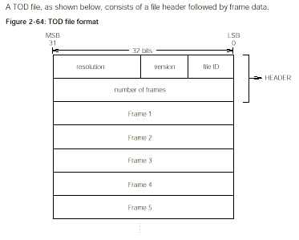

## Header

At the top of the TOD file, there is a 2-word (64-bit) HEADER, in which the following four kinds of information are described.

\(a\) File ID (8 bits)

This identifies the file as an animation file. Its value is 0x50.

\(b\) Version (8 bits)

Animation version. Its value starts at 0x00.

\(c\) Resolution (16 bits)

This is the time in which 1 frame is displayed (in units of ticks (1 tick = 1/60 seconds)).

\(d\) Number of frames (32 bits)

This is the number of frames described in the file.

## Frame

Following the header the frame is described. Frames are arranged chronologically

Each FRAME consists of a frame header followed by a PACKET, as shown below.

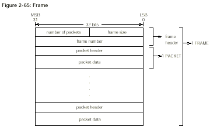

### Frame Header

There is a 2 word frame header at the beginning of each frame. The following information is described in a frame header.

Frame size (16 bits)

Frame length (including header) in words.

Number of packets (16 bits)

Number of packets.

Frame numbers (32 bits)

Frame number.

## PACKET

After the frame header come the PACKETS. Each PACKET consists of a one-word packet header at the top, followed by the packet data (see Figure 2-50). There are several different kinds of PACKETS.

The size of the packet data in each PACKET will of course be different if the PACKETS are of different kinds; even if the PACKETS are of the same kind, the size of the packet data may be different.

A PACKET consists of a packet header and packet data, as shown below.

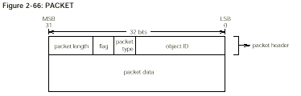

### Packet Header

The PACKET header contains the following information.

Object ID (16 bits)

The identification of the object to be handled.

Packet type (4 bits)

The type of packet data.

Flag (4 bits)

The meaning of the flag varies from packet to packet.

Packet length (8 bits)

This is the size of the packet (including the header) in units of words (4 bytes).

Object refers to a 3-dimensional object (a GsDOBJ2 structure) handled by libgs (the extended graphics library) which is to be made to reflect the packet data.

Packet type contains the classification of the data stored in the packet data. The significance of the flag varies according to the packet type.

Packet length indicates the length of the packet in units of words (4 bytes).

### Packet Data

Several kinds of data, such as the GsCOORDINATE2 structure RST value and the TMD data ID (the modeling data ID), are stored in the packet data.

The packet type slot in the header indicates which type the PACKET is. The relationship between the packet type value and the type of data is as follows:

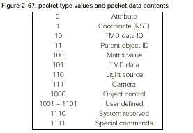

The different kinds of data are explained below.

### Packet Data-Attribute

When packet type is 0000, the data that designates attribute of the GsDOBJ structure in the packet data is stored. In this case a flag is not used.

Packet data is composed of 2 words as follows:

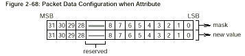

The first word is a mask which indicates the section which changes value and the section which does not change value. 0 is set in the bit which corresponds to the item which will change and 1 is set in the bit for the value which will not change.

In the second word, new data is input to the bits corresponding to items which are going to change, and the other bits are set to 0.

Note that the first and second words differ in the following respect: in the first word, the default value for the bits which are not going to be changed is 1, while in the second word, this default value is 0.

The breakdown of the bits of the second word packet data shown in Figure 2-52 is described below.

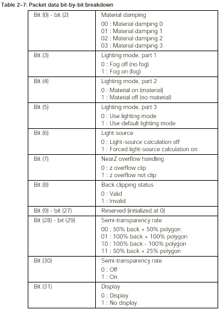

For example, to switch forced light-source calculation ON, the packet data bits should be set as shown in Figure 2-53.

Bit (6) of the first word is given the value 0, showing that the light source is to be changed. The other bits are given the value 1, showing that they are not going to be changed. Accordingly, the first word is 0xffbf.

Bit (6) of the second word is given the value 1 to indicate that forced light-source calculation is ON, and the other bits, which correspond to items which are not going to be changed, are given the default value 0. The second word is therefore 0x0040.

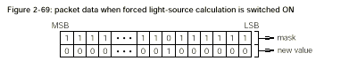

### Packet Data-Coordinate (RST)

When packet type is 0001, data that sets the coordinates of the GsDOBJ structure is stored in packet data.

In this case the flag will have the following meaning.

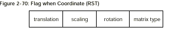

Matrix type: RST matrix type

0: Absolute value

1: Differential matrix from preceding frame Rotation: Rotation (R) flag 0: None 1: Has Scaling Screening (S) flag 0: None 1: Has Translation Parallel movement (T) flag 0: None 1: Has The configuration of packet data will differ according to the values of the flag rotation bit, the scaling bit, and the translation bit as per Figure 2-54.

In Figure 2-55, Rx, Ry and Rz indicate one degree as 4096, with a fixed point decimal value (1, 19, 12) that indicate the X axis component, the Y axis component, and the Z axis component of the angle of rotation. In the same way, Sx, Sy and Sz indicate the X axis component, the Y axis component, and the Z axis component of the scaling as a fixed point decimal (1, 3, 12), while Tx, Ty and Tz respectively indicate the X axis component, the Y axis component, and the Z axis component of the translation as an integer (1, 31, 0) that signals 32 bits.

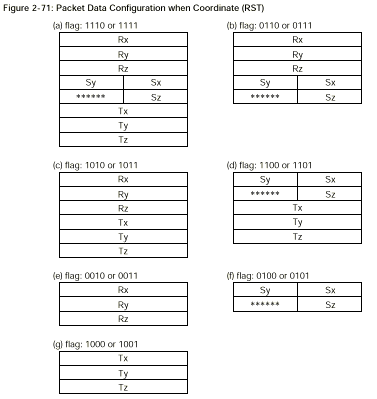

### Packet Data-TMD Data ID

When packet type is 0010, the modeling data ID (TMD data) of the real object is stored in the packet data (See Figure 2-56). The TMD data ID is composed of 2 bytes. In this case no flag is used.

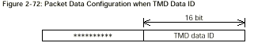

### Packet Data- Parent Object ID

When packet type is 0011, the parent object ID of the object specified is stored in packet data (see Figure 2-57). The parent object ID is composed of 2 bytes. In this case no flag is used.

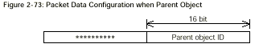

### Packet Data - MATRIX Value

When the packet type is 0100, the data which designates coord members of the GsCOORDINATE2 structure to which GsDOBJ2 structure points is stored in packet data. In this case a flag is not used.

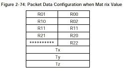

### Packet Data-TMD Data Body

When packet type is 0101, TMD data is stored. This is not presently supported.

### Packet Data-Light Source

When packet type is 0110, the data that designates light source is stored in packet data. When this is the case, the object ID is separate from the normal object ID and becomes the light source ID. Flags have the following meanings:

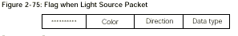

Data type: Data type

0: Absolute value

1: Difference from preceding frame

Direction: Direction flag

0: None

1: Has

Color: Color flag

0: None

1: Has

The configuration of packet data will differ according to the value of the flag direction bit and the color bit.

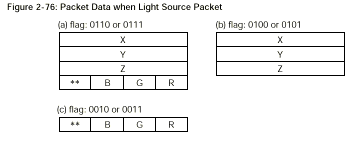

### Packet Data-Camera

When packet type is 0111, data which designates viewpoint location information is stored in the packet.

When this is the case, the object ID is separate from the normal object ID and becomes the camera ID.

Flags have the meaning indicated in Figure 2-61. Please be careful to note that the meaning of other bits will change depending on the type bit.

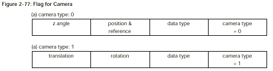

When camera type bit is 0 other bits are:

Data type: Data type

0: Absolute value

1: Difference from preceding frame

Position & reference Position and reference position flag 0: None 1: Has z angle Reference angle flag from level 0: None 1: Has When camera type bit is 1 other bits are:

Data type: Data type

0: Absolute value

1: Difference from preceding frame

Rotation: Rotation (R) flag

0: None

1: Has

Translation: Horizontal movement (T) flag 0: None 1: Has The structure of packet data differs according to the flag content, as shown in Figs.2-62 and 2-63.

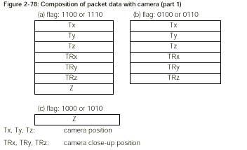

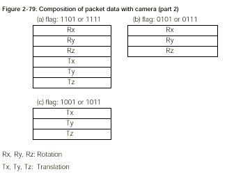

### Packet Data-Object Control

If the packet type is 1000, object control is not set. In this case, there is no packet data. The flag has the meanings shown below.

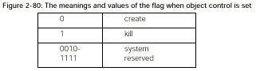

### Packet Data-Extended Commands

If the packet type is 1110, it shows the extended commands.

### Packet Data-Special Commands

If the packet type is 1111, animation control is performed. Details of these special commands have not yet been finalized.
