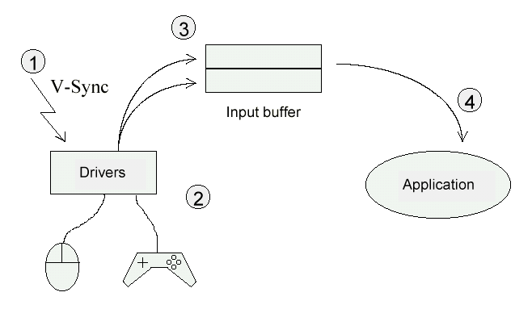

Tutorial Version 1.0 - A quick guide to Net Yaroze programming

## Controllers

Controllers are important devices that communicate the player's commands to the application. Two Controllers can be connected to the PlayStation. See Figure 2.0 for supported Controllers.

Figure 2.0

| Controller                     |
|--------------------------------|
| Mouse                          |
| NeGcon                         |
| Analog Controller (DUAL SHOCK) |
| Analog Controller              |
| Analog Joystick                |

Note: The Analog Controller (DUAL SHOCK) is supported but the shock feature is not.

## Reading Data From the Controllers

We will **not** be using the PadRead() routine to read in the data buffers since it doesn’t support the Controllers in analog mode. A new header file called cntrl.h will be used to support all the Controllers listed above and for every example in this tutorial. See Listing 3.0.

Listing 3.0

    //--------------------------------------------------------------------------
    // File: cntrl.h
    // Author: George Bain
    // Date: June 17, 1998
    // Description: Controller type macros and defines.
    // Copyright (C) 1998 Sony Computer Entertainment Europe.,
    // All Rights Reserved. Permission granted to whom ever.
    //--------------------------------------------------------------------------

    #ifndef _CNTRL_H
    #define _CNTRL_H

    //--------------------------------------------------------------------------
    // D E F I N E S
    //--------------------------------------------------------------------------

    // quit macro
    #define DONE (PAD_PRESS(buffer1,PAD_SELECT) && PAD_PRESS(buffer1,PAD_START))

    // terminal types
    #define MOUSE        (0x1)
    #define NEGCON       (0x2)
    #define NORMAL       (0x4)
    #define ANALOG_JOY (0x5)
    #define GUNCON (0x6)
    #define ANALOG (0x7)

    // mouse defines
    #define MOUSE_RIGHT (1<<2)
    #define MOUSE_LEFT (1<<3)
    #define MOUSE_NOKEY (0xFC)

    // controller defines 14 buttons, 16 when in analog mode
    #define PAD_NOKEY (0xFFFF)
    #define PAD_BAD      (0xFF)

    #define PAD_LEFT     (1<<7)
    #define PAD_RIGHT    (1<<5)
    #define PAD_UP       (1<<4)
    #define PAD_DOWN     (1<<6)

    #define PAD_TRIANGLE (1<<12)
    #define PAD_CIRCLE   (1<<13)
    #define PAD_CROSS    (1<<14)
    #define PAD_SQUARE   (1<<15)

    #define PAD_SELECT   (1<<0)
    #define PAD_START    (1<<3)

    #define PAD_L1       (1<<10)
    #define PAD_L2       (1<<8)
    #define PAD_L3       (1<<1)
    #define PAD_R1       (1<<11)
    #define PAD_R2       (1<<9)
    #define PAD_R3       (1<<2)

    // neGcon defines
    #define NEGCON_LEFT  (1<<7)
    #define NEGCON_RIGHT (1<<5)
    #define NEGCON_DOWN  (1<<6)
    #define NEGCON_UP    (1<<4)
    #define NEGCON_A     (1<<13)
    #define NEGCON_B     (1<<12)
    #define NEGCON_START (1<<3)
    #define NEGCON_R     (1<<11)

    // Namco guncon defines
    #define GUNCON_A     (1<<3)
    #define GUNCON_B     (1<<14)
    #define GUNCON_TRIGGER (1<<13)

    // controller check macros
    #define PAD_PRESS(x,y) (~(x)->data.pad & (y))

    #define MOUSE_PRESS(x,y) (~(x)->data.mouse.buttons & (y))
    #define MOUSE_X(x) ((x)->data.mouse.x_offset)
    #define MOUSE_Y(x) ((x)->data.mouse.y_offset)

    #define NEGCON_PRESS(x,y) (~(x)->data.negcon.buttons & (y))
    #define NEGCON_PRESS_L(x) ((x)->data.negcon.button_L)
    #define NEGCON_PRESS_I(x) ((x)->data.negcon.button_I)
    #define NEGCON_PRESS_II(x) ((x)->data.negcon.button_II)
    #define NEGCON_PRESS_TWIST(x) ((x)->data.negcon.twist)

    #define GUNCON_PRESS(x,y) (~(x)->data.guncon.buttons & (y))
    #define GUNCON_X(x) ((x)->data.guncon.guncon_x)
    #define GUNCON_Y(x) ((x)->data.guncon.guncon_y)
    #define GUNCON_DIV(x) ((x)->data.guncon.guncon_screen_div)

    #define ANALOG_LEFT_X(x) ((x)->data.analog.left_x)
    #define ANALOG_LEFT_Y(x) ((x)->data.analog.left_y)
    #define ANALOG_RIGHT_X(x) ((x)->data.analog.right_x)
    #define ANALOG_RIGHT_Y(x) ((x)->data.analog.right_y)

    //--------------------------------------------------------------------------
    // S T R U C T U R E S
    //--------------------------------------------------------------------------

    typedef struct guncon_tag
    {
        // 2 bytes
        u_short buttons; // button A, B, and TRIGGER
        // 4 bytes
        u_short guncon_x;           // x offset
        u_short guncon_y;        // y offset

    }guncon_data;

    typedef struct mouse_tag
    {
    char not_used;       // not used

    char buttons;            // 2nd bit: right, 3rd bit: left
    signed char x_offset;    // movement in x direction: -128~127
    signed char y_offset;    // movement in y direction: -128~127

    }mouse_data;

    typedef struct negcon_tag
    {
    u_short buttons;         // LEFT, RIGHT, DOWN, UP, START, A, B, and R

    u_char twist;            // the twist value
    u_char button_I;         // I button
    u_char button_II;        // II button
    u_char button_L;         // L button
    }negcon_data;

    typedef struct analog_tag
    {

    u_short buttons;     // 16 buttons
    u_char right_x;      // movement on right stick x direction: 0~255
    u_char right_y;      // movement on right stick y direction: 0~255
    u_char left_x;       // movement on left stick x direction: 0~255
    u_char left_y;       // movement on left stick y direction: 0~255

    }analog_data;

    typedef u_short pad_data; // 14 button controller

    typedef struct packet_tag
    {
        // 0-7
        u_char status; // 0xff: no controller, 0x00 controller connected
        u_char type; // upper 4 bits: terminal type
                     // lower 4 bits: size of data received / 2

        // 2-6 bytes of data
        // 2 bytes for 14 button controller
        // add 4 bytes for analog, now total of 6 bytes of received data

        union
         {
         pad_data pad;
         mouse_data mouse;
         analog_data analog;
         negcon_data negcon;
         guncon_data guncon;
    }data;

    }cntrl_data, *cntrl_ptr;

    //--------------------------------------------------------------------------
    // G L O B A L S
    //--------------------------------------------------------------------------

    // 8 bytes for each buffer
    cntrl_data *buffer1, *buffer2;

    #endif

    //----------------------------------EOF-------------------------------------

## Controller Types and Data Received

Communication with the Controllers takes place every Vsync. GetPadBuf() is used to obtain the contents of the buffer, which is different for each type of Controller. There are four steps taken when reading the received data. The first step begins with the V-Sync. During the second step, the Controller drivers are read. In the third step, the data is read into two buffers (one for each port). The last step is when your application reads the data in these buffers. See Figure 3.1.

Figure 3.1



The data stored in the 8-byte buffer for each port will give us valuable information. See Figure 3.2.

\*Note: There is actually 34-bytes stored in each buffer but since the Net Yaroze library doesn’t support the Multi-Tap we need not worry about the rest of the bytes.

Figure 3.2

```text
┌───────────┬─────────────────────────────────────────────────────────────────────────┐
│Byte 0     │0xff: no Controller or bad communication 0x00: Controller connected      │
├───────────┼──────────────────────────────────┬──────────────────────────────────────┤
│Byte 1     │Upper bits: terminal type         │Lower bits: size of received data / 2 │
├───────────┼──────────────────────────────────┴──────────────────────────────────────┤
│Byte 2     │Received data for digital                                                │
├───────────┤                                                                         │
│Byte 3     │e.g: 14 button Controller                                                │
├───────────┼─────────────────────────────────────────────────────────────────────────┤
│Byte 4     │Received data for analog                                                 │
├───────────┤                                                                         │
│Byte 5     │e.g: Analog Controller, and Mouse                                        │
├───────────┤                                                                         │
│Byte 6     │                                                                         │
├───────────┤                                                                         │
│Byte 7     │                                                                         │
└───────────┴─────────────────────────────────────────────────────────────────────────┘
```

## Standard Controller

Every PlayStation user has the standard controller and two of them came with your Net Yaroze. This controller only operates in digital mode with a total of 14 buttons. See Figure 3.3 for byte information of the buffer.

Figure 3.3

```text
┌────────────────────┬─────────────────────┬────────────────────┬─────────────────────┐
│Byte Number         │Type                 │Bit Number          │Button Assignment    │
├────────────────────┼─────────────────────┼────────────────────┼─────────────────────┤
│0                   │Buffer status        │All 8 bits          │0xFF: failure        │
│                    │                     │                    │                     │
│                    │                     │                    │0x00: success        │
├────────────────────┼─────────────────────┼────────────────────┼─────────────────────┤
│1                   │Data length          │Bits 0-3            │0x1                  │
│                    │                     │                    │                     │
│                    │Controller type      │Bits 4-7            │0x4                  │
├────────────────────┼─────────────────────┼────────────────────┼─────────────────────┤
│2                   │Status of digital    │Bit 15              │Square button        │
│                    │buttons              │                    │                     │
│3                   │                     │Bit 14              │Cross button         │
│                    │                     │                    │                     │
│                    │                     │Bit 13              │Circle button        │
│                    │                     │                    │                     │
│                    │                     │Bit 12              │Triangle button      │
│                    │                     │                    │                     │
│                    │                     │Bit 11              │R1 button            │
│                    │                     │                    │                     │
│                    │                     │Bit 10              │L1 button            │
│                    │                     │                    │                     │
│                    │                     │Bit 9               │R2 button            │
│                    │                     │                    │                     │
│                    │                     │Bit 8               │L2 button            │
│                    │                     │                    │                     │
│                    │                     │Bit 7               │Left button          │
│                    │                     │                    │                     │
│                    │                     │Bit 6               │Down button          │
│                    │                     │                    │                     │
│                    │                     │Bit 5               │Right button         │
│                    │                     │                    │                     │
│                    │                     │Bit 4               │Up button            │
│                    │                     │                    │                     │
│                    │                     │Bit 3               │Start button         │
│                    │                     │                    │                     │
│                    │                     │Bit 2               │Not used             │
│                    │                     │                    │                     │
│                    │                     │Bit 1               │Not used             │
│                    │                     │                    │                     │
│                    │                     │Bit 0               │Select button        │
├────────────────────┼─────────────────────┴────────────────────┴─────────────────────┤
│4                   │Not used                                                        │
├────────────────────┤                                                                │
│5                   │                                                                │
├────────────────────┤                                                                │
│6                   │                                                                │
├────────────────────┤                                                                │
│7                   │                                                                │
└────────────────────┴────────────────────────────────────────────────────────────────┘
```

## Analog Controller (DUAL SHOCK)

The Net Yaroze library supports the Analog Controller (DUAL SHOCK). However the shock feature is not supported. When the red LED light is **off**, the Analog Controller (DUAL SHOCK) is in digital mode and only 14 buttons are available.

On the Analog Controller, three modes are supported. The first is digital mode, when no LED lights are lit. The second and third is analog mode, when the LED light is green or red. The green LED light indicates it is on Analog Joystick mode, and the red LED light indicates normal Analog Controller mode. When in Analog Joystick mode you have an additional two buttons to include with the normal 14 buttons (L3 and R3).

Also note that you must include a calibration screen when using the Analog Controller and the Analog Joystick. No calibration screen is needed when using the Analog Controller (DUAL SHOCK) since it has a built-in auto-calibration function for center position calibration and maximum travel detection.

Therefore when you are in analog mode you have access to the left and right sticks and the buttons (14-Analog Controller, 16-Analog Joystick). See Figure 3.4 for byte information of the buffer.

Figure 3.4

```text
┌────────────────────┬─────────────────────┬────────────────────┬─────────────────────┐
│Byte Number         │Type                 │Bit Number / Value  │Button Assignment    │
├────────────────────┼─────────────────────┼────────────────────┼─────────────────────┤
│0                   │Buffer status        │All 8 bits          │0xFF: failure        │
│                    │                     │                    │                     │
│                    │                     │                    │0x00: success        │
├────────────────────┼─────────────────────┼────────────────────┼─────────────────────┤
│1                   │Data length          │Bits 0-3            │ 0x3                 │
│                    │                     │                    │                     │
│                    │Controller type      │Bits 4-7            │0x7                  │
├────────────────────┼─────────────────────┼────────────────────┼─────────────────────┤
│2                   │Status of digital    │Bit 15              │Square button        │
│                    │buttons              │                    │                     │
│3                   │                     │Bit 14              │Cross button         │
│                    │                     │                    │                     │
│                    │                     │Bit 13              │Circle button        │
│                    │                     │                    │                     │
│                    │                     │Bit 12              │Triangle button      │
│                    │                     │                    │                     │
│                    │                     │Bit 11              │R1 button            │
│                    │                     │                    │                     │
│                    │                     │Bit 10              │L1 button            │
│                    │                     │                    │                     │
│                    │                     │Bit 9               │R2 button            │
│                    │                     │                    │                     │
│                    │                     │Bit 8               │L2 button            │
│                    │                     │                    │                     │
│                    │                     │Bit 7               │Left button          │
│                    │                     │                    │                     │
│                    │                     │Bit 6               │Down button          │
│                    │                     │                    │                     │
│                    │                     │Bit 5               │Right button         │
│                    │                     │                    │                     │
│                    │                     │Bit 4               │Up button            │
│                    │                     │                    │                     │
│                    │                     │Bit 3               │Start button         │
│                    │                     │                    │                     │
│                    │                     │Bit 2               │R3 button            │
│                    │                     │                    │                     │
│                    │                     │Bit 1               │L3 button            │
│                    │                     │                    │                     │
│                    │                     │Bit 0               │Select button        │
├────────────────────┼─────────────────────┼────────────────────┼─────────────────────┤
│4                   │Analog Value         │0-255               │Right stick X value  │
├────────────────────┼─────────────────────┼────────────────────┼─────────────────────┤
│5                   │Analog Value         │0-255               │Right stick Y value  │
├────────────────────┼─────────────────────┼────────────────────┼─────────────────────┤
│6                   │Analog Value         │0-255               │Left stick X value   │
├────────────────────┼─────────────────────┼────────────────────┼─────────────────────┤
│7                   │Analog Value         │0-255               │Left stick Y value   │
└────────────────────┴─────────────────────┴────────────────────┴─────────────────────┘
```

Analog Joystick

The Analog Joystick is also supported with the Net Yaroze library. The Analog Joystick supports both digital and analog mode. This Analog Joystick is great for flying simulation games. See Figure 3.5 for byte information of the buffer.

Figure 3.5

```text
┌────────────────────┬─────────────────────┬────────────────────┬─────────────────────┐
│Byte Number         │Type                 │Bit Number / Value  │Button Assignment    │
├────────────────────┼─────────────────────┼────────────────────┼─────────────────────┤
│0                   │Buffer status        │All 8 bits          │0xFF: failure        │
│                    │                     │                    │                     │
│                    │                     │                    │0x00: success        │
├────────────────────┼─────────────────────┼────────────────────┼─────────────────────┤
│1                   │Data length          │Bits 0-3            │ 0x3                 │
│                    │                     │                    │                     │
│                    │Controller type      │Bits 4-7            │0x5                  │
├────────────────────┼─────────────────────┼────────────────────┼─────────────────────┤
│2                   │Status of digital    │Bit 15              │Square button        │
│                    │buttons              │                    │                     │
│3                   │                     │Bit 14              │Cross button         │
│                    │                     │                    │                     │
│                    │                     │Bit 13              │Circle button        │
│                    │                     │                    │                     │
│                    │                     │Bit 12              │Triangle button      │
│                    │                     │                    │                     │
│                    │                     │Bit 11              │R1 button            │
│                    │                     │                    │                     │
│                    │                     │Bit 10              │L1 button            │
│                    │                     │                    │                     │
│                    │                     │Bit 9               │R2 button            │
│                    │                     │                    │                     │
│                    │                     │Bit 8               │L2 button            │
│                    │                     │                    │                     │
│                    │                     │Bit 7               │Left button          │
│                    │                     │                    │                     │
│                    │                     │Bit 6               │Down button          │
│                    │                     │                    │                     │
│                    │                     │Bit 5               │Right button         │
│                    │                     │                    │                     │
│                    │                     │Bit 4               │Up button            │
│                    │                     │                    │                     │
│                    │                     │Bit 3               │Start button         │
│                    │                     │                    │                     │
│                    │                     │Bit 2               │Not used             │
│                    │                     │                    │                     │
│                    │                     │Bit 1               │Not used             │
│                    │                     │                    │                     │
│                    │                     │Bit 0               │Select button        │
├────────────────────┼─────────────────────┼────────────────────┼─────────────────────┤
│4                   │Analog Value         │0-255               │Right stick X value  │
├────────────────────┼─────────────────────┼────────────────────┼─────────────────────┤
│5                   │Analog Value         │0-255               │Right stick Y value  │
├────────────────────┼─────────────────────┼────────────────────┼─────────────────────┤
│6                   │Analog Value         │0-255               │Left stick X value   │
├────────────────────┼─────────────────────┼────────────────────┼─────────────────────┤
│7                   │Analog Value         │0-255               │Left stick Y value   │
└────────────────────┴─────────────────────┴────────────────────┴─────────────────────┘
```

## Mouse

The Mouse is also supported. See Figure 3.6 for buffer information.

Figure 3.6

```text
┌────────────────────┬─────────────────────┬─────────────────────┬────────────────────┐
│Byte Number         │Type                 │Bit Number / Value   │Button Assignment   │
├────────────────────┼─────────────────────┼─────────────────────┼────────────────────┤
│0                   │Buffer status        │All 8 bits           │0xFF: failure       │
│                    │                     │                     │                    │
│                    │                     │                     │0x00: success       │
├────────────────────┼─────────────────────┼─────────────────────┼────────────────────┤
│1                   │Data length          │Bits 0-3             │ 0x2                │
│                    │                     │                     │                    │
│                    │Controller type      │Bits 4-7             │0x1                 │
├────────────────────┼─────────────────────┼─────────────────────┼────────────────────┤
│2                   │Not used             │Not used             │Not used            │
├────────────────────┼─────────────────────┼─────────────────────┼────────────────────┤
│3                   │Status of digital    │Bit 7                │Not used            │
│                    │buttons              │                     │                    │
│                    │                     │Bit 6                │Not used            │
│                    │                     │                     │                    │
│                    │                     │Bit 5                │Not used            │
│                    │                     │                     │                    │
│                    │                     │Bit 4                │Not used            │
│                    │                     │                     │                    │
│                    │                     │Bit 3                │Left button         │
│                    │                     │                     │                    │
│                    │                     │Bit 2                │Right button        │
│                    │                     │                     │                    │
│                    │                     │Bit 1                │Not used            │
│                    │                     │                     │                    │
│                    │                     │Bit 0                │Not used            │
├────────────────────┼─────────────────────┼─────────────────────┼────────────────────┤
│4                   │Analog value         │-128~127             │X value             │
├────────────────────┼─────────────────────┼─────────────────────┼────────────────────┤
│5                   │Analog value         │-128~127             │Y value             │
├────────────────────┼─────────────────────┼─────────────────────┼────────────────────┤
│6                   │Not used             │Not used             │Not used            │
├────────────────────┼─────────────────────┼─────────────────────┼────────────────────┤
│7                   │Not used             │Not used             │Not used            │
└────────────────────┴─────────────────────┴─────────────────────┴────────────────────┘
```

##  NeGcon

The neGcon needs a calibration screen for center position correction of twist. To calibrate the neGcon obtain the value of twist when released from the user’s hand (in the neutral position). This value should be used as the center position value throughout the game. See Figure 3.7 for buffer information.

Figure 3.7

```text
┌────────────────────┬─────────────────────┬─────────────────────┬────────────────────┐
│Byte Number         │Type                 │Bit Number / Value   │Button Assignment   │
├────────────────────┼─────────────────────┼─────────────────────┼────────────────────┤
│0                   │Buffer status        │All 8 bits           │0xFF: failure       │
│                    │                     │                     │                    │
│                    │                     │                     │0x00: success       │
├────────────────────┼─────────────────────┼─────────────────────┼────────────────────┤
│1                   │Data length          │Bits 0-3             │ 0x3                │
│                    │                     │                     │                    │
│                    │Controller type      │Bits 4-7             │0x2                 │
├────────────────────┼─────────────────────┼─────────────────────┼────────────────────┤
│2                   │Status of digital    │Bit 15               │Not used            │
│                    │buttons              │                     │                    │
│3                   │                     │Bit 14               │Not used            │
│                    │                     │                     │                    │
│                    │                     │Bit 13               │A button            │
│                    │                     │                     │                    │
│                    │                     │Bit 12               │B button            │
│                    │                     │                     │                    │
│                    │                     │Bit 11               │R button            │
│                    │                     │                     │                    │
│                    │                     │Bit 10               │Not used            │
│                    │                     │                     │                    │
│                    │                     │Bit 9                │Not used            │
│                    │                     │                     │                    │
│                    │                     │Bit 8                │Not used            │
│                    │                     │                     │                    │
│                    │                     │Bit 7                │Left button         │
│                    │                     │                     │                    │
│                    │                     │Bit 6                │Down button         │
│                    │                     │                     │                    │
│                    │                     │Bit 5                │Right button        │
│                    │                     │                     │                    │
│                    │                     │Bit 4                │Up button           │
│                    │                     │                     │                    │
│                    │                     │Bit 3                │Start button        │
│                    │                     │                     │                    │
│                    │                     │Bit 2                │Not used            │
│                    │                     │                     │                    │
│                    │                     │Bit 1                │Not used            │
│                    │                     │                     │                    │
│                    │                     │Bit 0                │Not used            │
├────────────────────┼─────────────────────┼─────────────────────┼────────────────────┤
│4                   │Analog value         │0-255                │Centre              │
├────────────────────┼─────────────────────┼─────────────────────┼────────────────────┤
│5                   │Analog value         │0-255                │I button            │
├────────────────────┼─────────────────────┼─────────────────────┼────────────────────┤
│6                   │Analog value         │0-255                │II button           │
├────────────────────┼─────────────────────┼─────────────────────┼────────────────────┤
│7                   │Analog value         │0-255                │L button            │
└────────────────────┴─────────────────────┴─────────────────────┴────────────────────┘
```

## Guncon

If using the Guncon, a center position calibration mode is necessary. See Figure 3.8 for more buffer information.

Figure 3.8

```text
┌────────────────────┬─────────────────────┬─────────────────────┬────────────────────┐
│Byte Number         │Type                 │Bit Number / Value   │Button Assignment   │
├────────────────────┼─────────────────────┼─────────────────────┼────────────────────┤
│0                   │Buffer status        │All 8 bits           │0xFF: failure       │
│                    │                     │                     │                    │
│                    │                     │                     │0x00: success       │
├────────────────────┼─────────────────────┼─────────────────────┼────────────────────┤
│1                   │Data length          │Bits 0-3             │ 0x3                │
│                    │                     │                     │                    │
│                    │Controller type      │Bits 4-7             │0x6                 │
├────────────────────┼─────────────────────┼─────────────────────┼────────────────────┤
│2                   │Status of digital    │Bit 15               │Not used            │
│                    │buttons              │                     │                    │
│3                   │                     │Bit 14               │B button            │
│                    │                     │                     │                    │
│                    │                     │Bit 13               │Trigger button      │
│                    │                     │                     │                    │
│                    │                     │Bit 12               │Not used            │
│                    │                     │                     │                    │
│                    │                     │Bit 11               │Not used            │
│                    │                     │                     │                    │
│                    │                     │Bit 10               │Not used            │
│                    │                     │                     │                    │
│                    │                     │Bit 9                │Not used            │
│                    │                     │                     │                    │
│                    │                     │Bit 8                │Not used            │
│                    │                     │                     │                    │
│                    │                     │Bit 7                │Not used            │
│                    │                     │                     │                    │
│                    │                     │Bit 6                │Not used            │
│                    │                     │                     │                    │
│                    │                     │Bit 5                │Not used            │
│                    │                     │                     │                    │
│                    │                     │Bit 4                │Not used            │
│                    │                     │                     │                    │
│                    │                     │Bit 3                │A button            │
│                    │                     │                     │                    │
│                    │                     │Bit 2                │Not used            │
│                    │                     │                     │                    │
│                    │                     │Bit 1                │Not used            │
│                    │                     │                     │                    │
│                    │                     │Bit 0                │Not used            │
├────────────────────┼─────────────────────┼─────────────────────┼────────────────────┤
│4                   │Analog value         │0-65,534             │X value             │
│                    │                     │                     │                    │
│5                   │                     │                     │                    │
├────────────────────┼─────────────────────┼─────────────────────┼────────────────────┤
│6                   │Analog value         │0-65,534             │Y value             │
│                    │                     │                     │                    │
│7                   │                     │                     │                    │
└────────────────────┴─────────────────────┴─────────────────────┴────────────────────┘
```

Check out the sample programs, which demonstrates the capabilities of these controllers.
